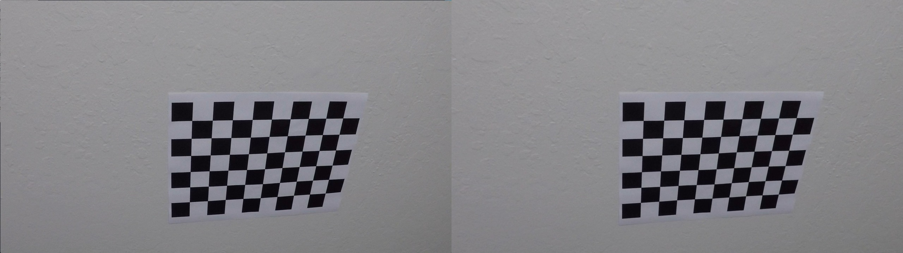
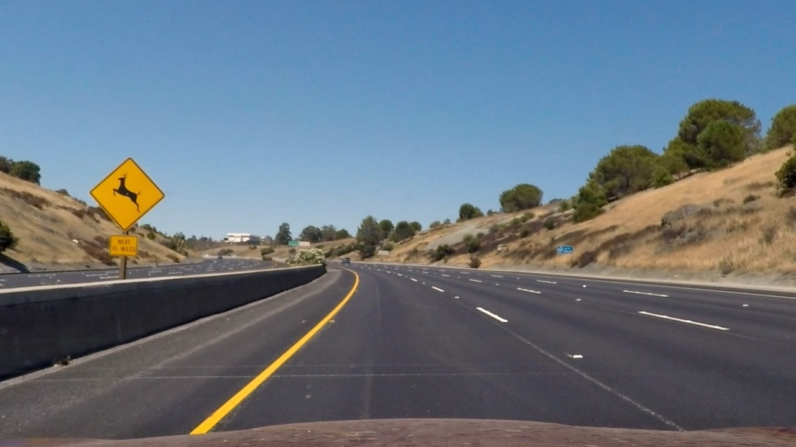
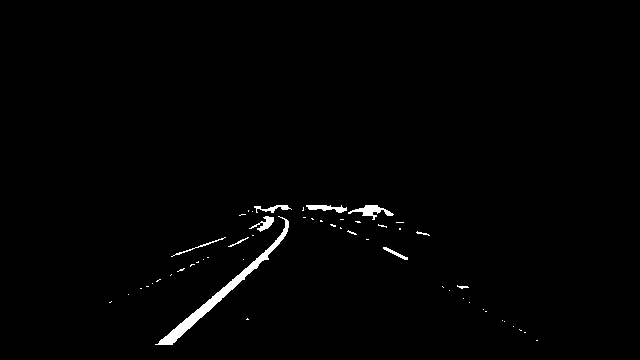
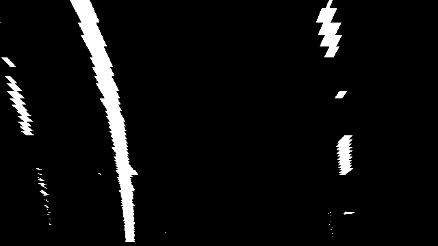
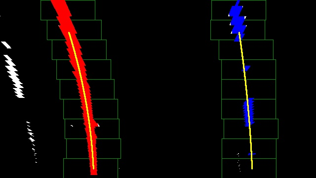
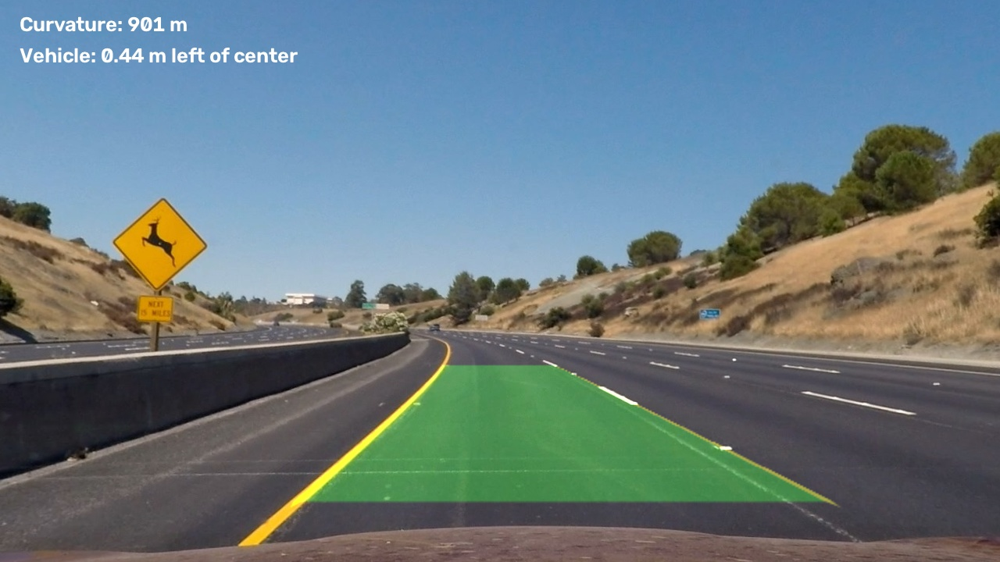

# Lane Finding Project

## Kalibracija kamere

`calibration.py` pronalazi 9 × 6 unutrašnjih uglova table pomoću
`findChessboardCorners`, precizira ih pomoću `cornerSubPix` i računa matricu
kamere i distorziju pomoću `calibrateCamera`. Koristi se 17 od 20 fotografija.
Dve fotografije imaju jedan dodatni red i kolonu, pa se sve dovode na
1280 × 720. RMS greška reprojekcije iznosi približno 0,8461 piksela.
Parametri se čuvaju u `outputs/calibration/calib.npz`.

## Obrada slike

`lane_detection.py`, funkcija `process_frame`, prvo primenjuje `cv.undistort`
sa izračunatim parametrima. Obrada se zatim radi na 640 × 360, a konačni
prikaz ostaje u originalnoj rezoluciji.

### Binarna maska

HLS i LAB prostor boje izdvajaju žute oznake. Bele oznake koriste prag
svetline, slabu zasićenost i lokalni kontrast dobijen horizontalnim top-hat
operatorom. Gaussov filtar smanjuje šum, a Sobelov izvod po x osi dodaje
odgovarajuće ivice. Maske se kombinuju i ograničavaju na trapez područja puta.

### Perspektiva

Koristi se zadata funkcija `warper` iz `example.py`. Za referencu 1280 × 720
izvorne tačke su `(585,460)`, `(695,460)`, `(1127,720)` i `(203,720)`.
Koordinate se prepolovljavaju za radnu sliku. Odredište je pravougaonik od
x = 160 do x = 480 i od y = 0 do y = 359. Perspektiva je odabrana za položaj
kamere u ovom snimku.

### Pikseli granica i polinomi

Funkcija `fit_lines` pomoću histograma donje polovine slike pronalazi početke
leve i desne granice. Devet kliznih prozora pretražuje oznake od dna ka vrhu.
`np.polyfit` prilagođava polinome `x(y) = a*y² + b*y + c`. Pikseli sa velikim
odstupanjem se odbacuju. Proveravaju se širina trake i promena širine po visini.

### Krivina i položaj vozila

Horizontalna skala dobija se iz pretpostavljene širine trake od 3,7 m i
izmerene širine pri dnu slike. Uzdužna skala je 30/360 m po pikselu.
Za srednji polinom u metrima računa se
`R = (1 + (2*A*y + B)²)^(3/2) / |2*A|`.
Bočni pomeraj je razlika položaja centra vozila i sredine između granica,
pomnožena horizontalnom skalom. Pretpostavlja se centralni položaj kamere.
Vrednosti su približne jer fizičke dimenzije scene nisu izmerene.

### Konačni prikaz

`fillPoly` popunjava oblast između polinoma. Inverzna perspektiva vraća je
na frontalnu sliku, a `addWeighted` dodaje zelenu površinu na korigovan kadar.
`putText` ispisuje numeričke procene.

## Video

[Obrađeni project_video03.mp4](outputs/videos/project_video03/project_video03_output.mp4)

`run_project.py` obrađuje svih 1.260 kadrova jednog snimka. Rezultat zadržava
1280 × 720, 25 kadrova/s i originalni audio. Prihvaćeni polinomi ublažavaju se
prosekom 30% novog i 70% prethodnog rezultata. U izvršenoj obradi par granica
pronađen je u 1.258 kadrova; u dva kadra prikazuje se da traka nije detektovana.
Ovaj broj predstavlja dostupnost detekcije, a ne nezavisno izmerenu tačnost.

## Ograničenja

Senke, odsjaj i izbledele oznake mogu poremetiti masku. Fiksna perspektiva
odgovara ovom snimku i zahteva prilagođavanje pri promeni položaja kamere.
Oštre krivine, zaklanjanje i neravan put mogu narušiti polinomski model.
Za preciznije metričke vrednosti potrebni su poznati parametri položaja kamere
i fizičke dimenzije puta. Moguća poboljšanja su prilagodljiva perspektiva i
bolje izdvajanje oznaka pri promenama osvetljenja.
